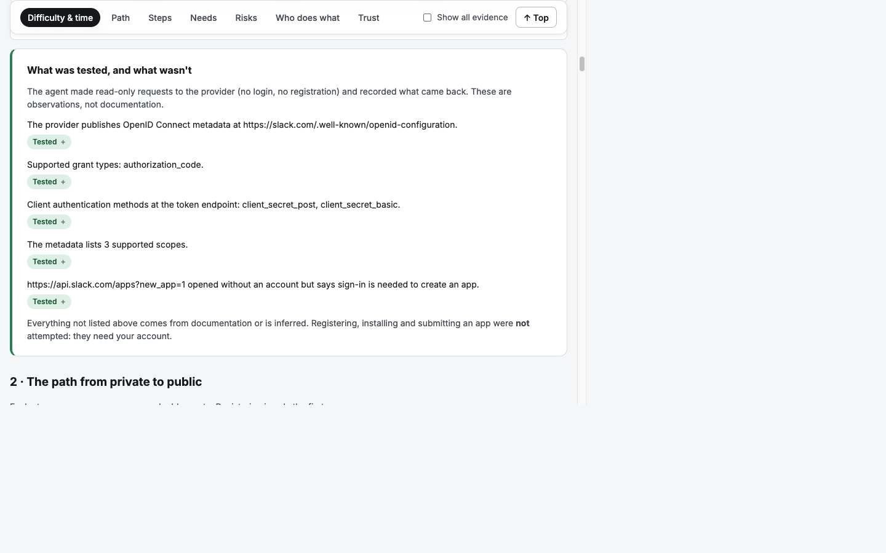

# OAuth Guide Agent

Type an app name or a website. An agent reads its developer docs, tests them live against the provider, and
writes an OAuth setup guide a developer can follow and share: **how hard it is, how long it takes (including any approval wait),
what the requirements and traps are, and what an AI agent can do versus what you must do yourself.**

Every statement carries a label (**Tested**, **Official docs**, **Inferred**, **Unknown**), a source, a date, and, for documentation
claims, an exact quote that code has checked against the fetched page.



| | |
|---|---|
| **Demo: fourteen real apps** and a live walkthrough | [docs/DEMO.md](docs/DEMO.md) |
| **Verification: what was checked, corrected, and could not be verified** | [docs/VERIFICATION.md](docs/VERIFICATION.md) |
| **Saved guides** (16, open in the app's *Saved guides* section) | [`guides/`](guides) |

## The problem this addresses

An agent builder wants their users to connect an app (Slack, Notion, Linear…). Each connection is a token the user grants to an
**OAuth app that the builder registers with the provider**: a record in the provider's developer portal with a client ID and secret,
redirect URIs and scopes. The user sees that app's name on the consent screen, and the provider applies its rate limits to it.
Some providers also review the app before anyone outside the owner's own workspace can use it.

Platforms that handle connections for you can supply that OAuth app, so you can start without registering one. Composio's
[managed OAuth apps](https://docs.composio.dev/toolkits/managed-auth) catalogue lists where it does, and its
[managed vs custom auth](https://docs.composio.dev/docs/authentication/custom-app-vs-managed-app) page says when you still need your own:
your name on the consent screen, scopes beyond the defaults, dedicated rate limits, a custom or regional instance, or enterprise requirements.
**That is the path this project covers**: registering your own provider OAuth app and getting it ready for other people to use. It is where the
unpredictable parts are (a sign-in wall, a review queue of days or weeks, a requirement you find out about late) and where developers
currently piece docs together and email the provider.

**What was decided, and why**

- **Guide the custom-app path, not the connection library.** The developer's question is "how long, how hard, what blocks me, who does what", not how to call an SDK.
- **Evidence over fluency.** A model writes the guide, but every documentation claim must carry an exact quote that code finds on the cited page, and the agent labels what it tested, what the docs say and what it only inferred.
- **The agent does what it safely can.** It reads the docs, runs harmless live checks against the provider (see below) and stops at the sign-in wall. It never registers, installs or submits anything, because that needs your account and creates real state.
- **A working slice, not 100 guides.** The agent runs on any app, and a set of varied real apps is saved as a library. Scaling to 100 means running the same agent over a list of apps; the cost is time and model calls, not new code.

## Quick start

You need Python 3.10+, Node 20+ (developed on Node 22) and a [Gemini API key](https://aistudio.google.com/apikey).

```bash
cp .env.example .env                 # then set GEMINI_API_KEY (and optionally GEMINI_MODEL)
python3 -m venv .venv && source .venv/bin/activate
pip install -r requirements.txt      # just jsonschema; the agent itself uses only the standard library

cd nuxt-app
npm install
npm run dev                          # http://localhost:3000
```

Open a **Saved guide** (the sidebar and the *Saved guides* page list all of them), or paste any website or app name (`Calendly`, `linear.app`, `https://developers.figma.com`) into the big search bar and press **Research**. A run takes
roughly 1.5 to 3 minutes. On first landing the right-hand column is empty and says to paste a URL or open a saved guide; during a run it becomes a large animated "watch the agents work" scene, and the guide opens when it finishes.

The web app starts the Python agent for you (it uses `../.venv/bin/python`, otherwise `python3`).

**Command line instead:**

```bash
python agent/guide_agent.py linear.app --out out/linear.json --trace out/linear.trace.json
```

Options: `--max-pages 20`, `--max-seconds 300`, `--max-steps 10` (agent-loop steps; `0` = first pass only), `--no-probes` (skip live
checks), `--model <id>`. Check any guide's quotes against their sources with `python tools/recheck_quotes.py guides/*-agent.json`.

### Configuration

| Variable | Purpose |
|---|---|
| `GEMINI_API_KEY` | Your Gemini key. Never commit `.env`. |
| `GEMINI_MODEL` | Model to use. Blank = auto-detect a Flash model. Smaller "flash-lite" models were the most reliable under load. |
| `GEMINI_FALLBACK_MODELS` | Comma-separated models to try when the main one is overloaded (503/429) or unavailable (404). |
| `FIRECRAWL_API_KEY` | Optional: use [Firecrawl](https://firecrawl.dev) for web search and to render JavaScript-only docs pages (see below). `--no-firecrawl` ignores it. |
| `FIRECRAWL_MAX_SCRAPES` | Most new pages rendered through Firecrawl per run (default 25; each costs credits). |
| `RESEARCH_COOLDOWN_SECONDS` | Hosting only: minimum seconds between runs per IP (the Docker image sets 60). |
| `OAUTH_AGENT_ROOT` | Hosting only: project root if the Nuxt app is not run from `nuxt-app/`. |

### Optional: Firecrawl

Set `FIRECRAWL_API_KEY` and the agent uses [Firecrawl](https://firecrawl.dev) in two places, with the built-in code as the fallback for both:

- **Web search** goes through Firecrawl's search API (ahead of Tavily, Brave and DuckDuckGo).
- **Pages the built-in reader cannot use** (an empty JavaScript shell, or a refusal to a script) are re-read through Firecrawl's scrape API and converted to plain text, so quotes still match what a person sees.

It is never used to get around a block: pages disallowed by `robots.txt` are skipped, as are `robots.txt`/sitemaps. If the key is invalid or the credits run out, Firecrawl switches off for the rest of the run. Each page read through it is marked `via: firecrawl` in the trace, and the save-time re-test re-reads those pages the same way. `python tests/firecrawl_test.py` tests all of this against a fake Firecrawl server.

## How it works

```
 app name / URL
      │
      ▼
 discover ── homepage, llms.txt, sitemaps, web search, URL guesses (all only candidates, never evidence)
      │
      ▼
 agent loop ── Gemini sees a checklist of what the guide still lacks and picks one tool per turn:
      │        fetch_page · list_links · search_pages · web_search · record_finding · finish
      │        (code owns the budget, the domain scope and the safety guard)
      ▼
 verify ── CODE checks every quote against the fetched text. A claim without a real quote is dropped and listed.
      │
      ▼
 live probes ── harmless requests to the provider: OAuth metadata, how the authorize and token endpoints treat an
      │         unregistered client or invalid code, how the API answers with no token, and whether the
      │         developer portal sits behind a sign-in wall (no login, no registration)
      ▼
 judge + assemble ── difficulty, waits, tiers, OAuth setup, requirements, limits, blockers, hand-offs → guide JSON
      │
      ▼
 test-then-save gate ── every cited page is fetched again and every quote re-checked; failures are removed
      │
      ▼
 validate against guides/guide.schema.json
```

The web app is a Nuxt 3 app. Its server route starts the Python agent and streams the agent's log to the browser, which drives the
stage chips, live counters and the pixelated working screen.

## Key decisions

1. **Evidence over fluency.** Four labels on every claim. A model can say anything, so a *documentation* claim must carry a quote that code finds verbatim in the fetched page; otherwise it is dropped and shown under "Not verified".
2. **Tested means observed, and nothing is saved untested.** The agent may label something **Tested** only when its own test saw it (a live probe, or the save gate re-finding a quote), with a distinct source type (`agent_probe`) so it is never confused with a person's hands-on test (`manual_test`). Before a guide is saved, every cited page is fetched again and every quote re-checked; a claim that fails is removed.
3. **Never register, install or submit.** Those steps need your account and create real state, so the guide hands them to you and says where the agent was stopped (for example "redirected to `github.com/login`").
4. **An agent loop, with code in charge.** The model decides what to read next, but code enforces the step and time budget, restricts fetches to the provider's own domains, and re-checks every recorded quote.
5. **"Not found" beats a guess.** A review stage must state a duration to count as a wait; otherwise the guide says the wait is not published. A "fix" that fills a blank with plausible text would be worse than the blank.
6. **A fixed, comparable schema** with an `extras` escape hatch, validated on every run, so guides for different providers line up.
7. **Verify with outside evidence.** Checking quotes is not enough (see [VERIFICATION](docs/VERIFICATION.md)): the worst defects had real quotes. Relevance and duration guards were added after comparing against independent sources and human-tested guides.
8. **Reliability.** Overloaded or unavailable models trigger a fallback chain; runs have hard time and step limits.

## Verification in one paragraph

In the latest full pass, **504 of 504** documentation quotes across the fourteen agent-researched guides were re-found at their sources on a fresh fetch, none fabricated, and each guide also passed its own save-time test. (That pass also caught drift: three Notion quotes that were found when the guide was saved were gone two days later because Notion had changed the page, so Notion was re-researched.) A manual sample against independent sources **confirmed** limits and waits for
Notion, Calendly, Google and Slack, reproduced the live-test observations with `curl`, and **found real mistakes**: Spotify's hardest gate was missing, GitHub's steps included
seven unrelated Copilot steps, steps from pages like Dropbox's and Linear's OAuth docs were silently discarded, some "approval waits" were not waits, and three live observations were misleading or false. All were fixed or
flagged. Details, including what could not be verified, are in [docs/VERIFICATION.md](docs/VERIFICATION.md).

## Limitations

- **It is research, not a hands-on test.** The agent cannot create an app, so form fields, required fields and behaviour behind a login are not seen. A person who actually registered found details the agent's GitHub guide lacks (see the hand-tested [GitHub](guides/github.json) guide).
- **"Time to get started" is Unknown** in every agent guide; only a hands-on attempt shows it.
- **Difficulty ratings and the "what an agent can do" lists are model judgement** (labelled *Inferred*). They depend on coverage: Spotify moved from medium to hard once the missing gate was found.
- **Coverage varies.** If a provider's docs are JavaScript-rendered, thin, blocked for crawlers by `robots.txt`, or spread across many pages, the guide has gaps and says "Not found". Some guides have few steps (Notion, Google: 1). Zoom's main docs host returned only stubs, so its guide was researched from `developers.zoom.us` directly.
- **OAuth setup section.** Each guide has a section for the OAuth connection itself: authorization and token URLs, grant types, client ID and secret, redirect URI rules, PKCE, scopes and token lifetimes. Rows are quoted from the docs and re-checked when the guide is saved; a URL or figure is shown as the value only if it appears in the quote. The agent cannot finish until it has read a page that explains the flow, and the live probes add tested rows for the authorize and token endpoints. Guides saved before this section existed show it empty until they are researched again. If a provider has several OAuth routes (Stripe Apps and Connect, for example), the agent may cover only some; check which the rows cite.
- **Runs are not deterministic.** Two runs of the same app can list different limits or blockers.
- **Live tests are modest and vary by provider.** At most 14 requests; they honour `robots.txt` (Slack's blocks the OAuth path, so that check is skipped) and need no account, so many providers expose little to test. Several guides (Asana, Google, Linear, Shopify, Spotify, Zoom) have only the save-gate result as a tested claim. Everything the guide states beyond that is documentation (re-checked against its source when saved) or labelled *Inferred*.
- **Provider-specific traps.** Metadata can describe a different product (Figma's is for its MCP server); probes caveat this, but cannot always tell.
- **English docs only.** Not tested on other languages.
- **One run at a time**, because each run makes many Gemini calls. Free-tier rate limits apply.
- **Hosting.** The UI has no login, so on a public host your Gemini quota is exposed. The per-IP cooldown and one-run-at-a-time limit reduce, not remove, that risk; put it behind authentication for anything beyond a demo. The outbound-request guard blocks private and internal addresses but cannot fully stop DNS rebinding (see `agent/netguard.py`).
- **The Dockerfile has not been built** in this environment (Docker was not available). The production Nuxt build (`npm run build`, then `node .output/server/index.mjs`) was run and tested.

## Hosting

```bash
docker build -t oauth-guide-agent .
docker run -p 3000:3000 -e GEMINI_API_KEY=your-key -e GEMINI_MODEL=gemini-3.1-flash-lite oauth-guide-agent
```

Any container host works (Render, Fly.io, Railway, Cloud Run). Set `GEMINI_API_KEY` (and `FIRECRAWL_API_KEY`) as secret environment variables, not in the image. Without Docker:

```bash
cd nuxt-app && npm ci && npm run build
OAUTH_AGENT_ROOT=.. NITRO_PORT=3000 RESEARCH_COOLDOWN_SECONDS=60 node .output/server/index.mjs
```

### Credentials on a host (Vercel, Docker, anything)

Keys are read from real environment variables first, and from a local `.env` only if a variable is not set. `.env` is git-ignored and never
pushed. On Vercel, add `GEMINI_API_KEY`, `FIRECRAWL_API_KEY` (and optionally `GEMINI_MODEL`, `RESEARCH_COOLDOWN_SECONDS`) under
*Project → Settings → Environment Variables*; the Settings panel then reports the key source as "environment variable".

**Caveat for Vercel specifically.** Live research starts a Python process that runs for 2 to 4 minutes and writes its result to disk. That fits a
container host. Serverless functions have execution-time limits, a read-only file system (apart from `/tmp`) and may not ship Python, and the
app reads `agent/` and `guides/` from outside `nuxt-app/`. Use a container host for the live-generation experience; Vercel suits at most the
read-only saved-guides library. This has not been tried on Vercel.

## Layout

```
agent/guide_agent.py   discover · agent loop · verify · assemble (standard library only)
agent/probes.py        harmless live tests against the provider (metadata, authorize, token, API, portal)
agent/savecheck.py     test-then-save gate: re-fetch every cited page, re-check every quote, drop what fails
agent/netguard.py      outbound-request guard (http(s) only, public addresses only, redirects re-checked)
guides/                schema, hand-tested GitHub and Slack guides, fourteen agent-generated guides with their traces
nuxt-app/              the web app (Nuxt 3): sidebar, big search home, animated agents-at-work scene, saved-guides library, guide page with sections nav and research panel, API routes
tools/                 recheck_quotes.py (independent re-check), summarize_guides.py (the comparison table in docs/DEMO.md)
tests/                 unit_test.py, probe_test.py (+ serve.py fake OAuth server), firecrawl_test.py (fake Firecrawl API)
docs/                  DEMO.md, VERIFICATION.md, screenshots
```

## Tests

```bash
python tests/unit_test.py                       # safety guard, accuracy fixes (no network)
python tests/serve.py &  python tests/probe_test.py   # live probes against a fake OAuth server
python tests/firecrawl_test.py                  # Firecrawl search/render/fallback against a fake Firecrawl API
```
