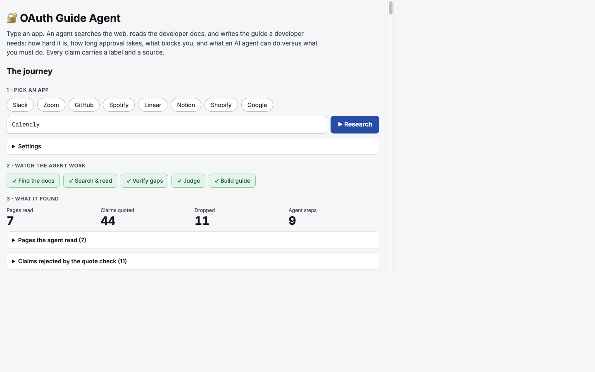
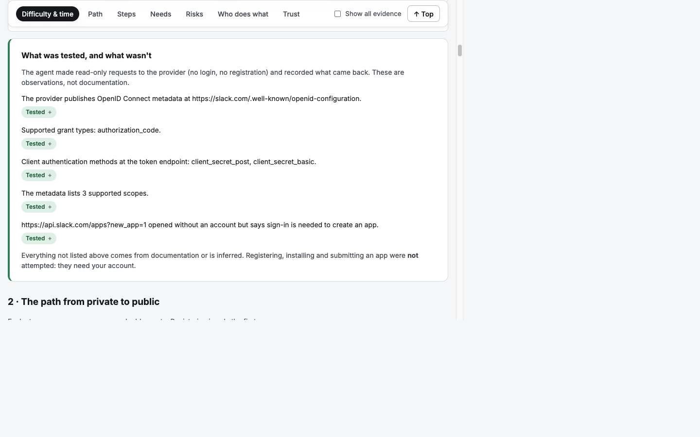

# Demo: nine real apps, different setup challenges

All guides below were generated by the agent from each provider's public docs plus read-only live checks, using the final code.
They are saved in [`guides/`](../guides) as `<app>-agent.json` (with their traces), validate against the schema, and open in
the web app's **Saved guides**. Runs took **85-175 seconds each** from the command line; the unfamiliar-app run in the UI took **182 seconds**.

## Results at a glance

Generated by [`tools/summarize_guides.py`](../tools/summarize_guides.py); every count comes from the guide JSON.

| App | Start | Public | Approval wait | Tiers | Steps | Reqs | Limits | Blockers | Docs claims | Tested (agent / person) | Inferred | Unknown |
|---|---|---|---|---|---|---|---|---|---|---|---|---|
| GitHub | easy | medium | not found in docs | 3 | 8 | 12 | 8 | 10 | 40 | 2 / 0 | 5 | 2 |
| Slack | easy | hard | Preliminary review: up to 10 business days; Functional review: up to 10 weeks | 3 | 11 | 7 | 7 | 9 | 46 | 5 / 0 | 5 | 1 |
| Spotify | easy | hard | Extended quota mode review: up to six weeks | 2 | 9 | 7 | 1 | 5 | 29 | 0 / 0 | 5 | 1 |
| Shopify | easy | hard | not found in docs | 5 | 4 | 8 | 2 | 8 | 31 | 0 / 0 | 6 | 2 |
| Notion | easy | hard | Initial review: 5-10 business days | 2 | 1 | 8 | 4 | 9 | 29 | 1 / 0 | 7 | 1 |
| Google | easy | hard | Automated branding review: a few minutes; Sensitive scope verification: up to 10 days; Manual brand verification: 2-3 business days | 3 | 1 | 11 | 8 | 16 | 53 | 0 / 0 | 7 | 1 |
| Figma | medium | hard | not found in docs | 2 | 22 | 9 | 4 | 7 | 47 | 6 / 0 | 5 | 2 |
| Asana | easy | medium | Initial response: within one week; Security and QA review: may take longer | 3 | 3 | 7 | 1 | 9 | 25 | 0 / 0 | 6 | 1 |
| Calendly | easy | unknown | not found in docs | 1 | 11 | 3 | 6 | 6 | 30 | 5 / 0 | 4 | 3 |

"Tested (agent / person)" counts distinct claims. The agent's tests are read-only live probes; "person" would be a hands-on manual
test (only the hand-written [GitHub](../guides/github.json) and [Slack](../guides/slack.json) guides have those: 19 and 8).
"Not found in docs" means the pages read state no review duration; the guide says so instead of guessing.

## Why these apps: each has a different challenge

| App | The setup challenge it shows |
|---|---|
| **GitHub** | Self-serve in minutes, but behind a sign-in wall (observed live: both the "new OAuth app" page and the authorize endpoint redirect to `github.com/login`). Going public means meeting Marketplace listing requirements. |
| **Slack** | A staged review: up to 10 business days for the preliminary review, then up to 10 weeks for the functional review of a new app. The agent also found that Slack's `robots.txt` blocks the OAuth path and skipped it. |
| **Spotify** | An app starts in a restricted development mode. Extended quota (public use) is for **organizations only, with at least 250k monthly active users**, and review takes **up to six weeks**. |
| **Shopify** | Dev Dashboard and CLI setup, then a formal App Store review. Five access stages. **No review duration is published**, and the guide says so. |
| **Notion** | Internal integrations are easy; a public integration needs a marketplace listing review of 5-10 business days. |
| **Google** | Scope sensitivity drives everything: testing mode caps at 100 users with 7-day refresh tokens; sensitive scopes need verification (up to 10 days); restricted scopes add an annual security assessment. |
| **Figma** | The longest setup path (22 steps). The live probe found OAuth metadata that belongs to Figma's *MCP server*; the guide labels it that way instead of presenting it as the app OAuth flow. |
| **Asana** | A review where the docs promise only an initial response within a week, "may take longer" after that. |
| **Calendly** | The **unfamiliar app**, never researched before this run. Typed as the bare name "Calendly" (resolved to `calendly.com`). PKCE is mandatory, Sandbox and Production apps differ, the client secret is shown only once. No public-listing process is documented, so "unknown". |

## Screenshots

**Typing an unfamiliar app:** the right-hand side switches to a large pixelated "working" screen (animated low-resolution
background, pixel font, a five-segment stage bar and the agent's live log) while the left rail shows stage chips and live counters.
When the run finishes the screen is replaced by the guide.

**The finished Calendly guide (the unfamiliar app), with live stats and all five stages done:**

**Every guide says what was tested and what wasn't** (Slack shown: five observations the agent made itself):

## Try it live

1. Start the app (see the [README](../README.md)): `npm run dev` in `nuxt-app/`, then open http://localhost:3000.
2. Open any **Saved guide** to see a finished result, or type any app name or URL and press **Research**.
3. Watch the stage chips, the live log and the counters. A run takes about 1.5 to 3 minutes. Lower **Agent steps** in Settings (for example 3) for a faster, shallower run.
4. In the guide, use the sticky links to jump to a section, tick **Show all evidence** to open every source, and read **What was tested, and what wasn't** first.
5. **Reset** removes everything the agent generated (`out/`) and keeps the hand-researched guides.

Good unfamiliar apps to try: Dropbox, Atlassian, Zoom, Linear, HubSpot, Box, Typeform. If the Gemini API is overloaded the agent
retries and falls back to other models automatically; the log shows `switching to fallback model`.
